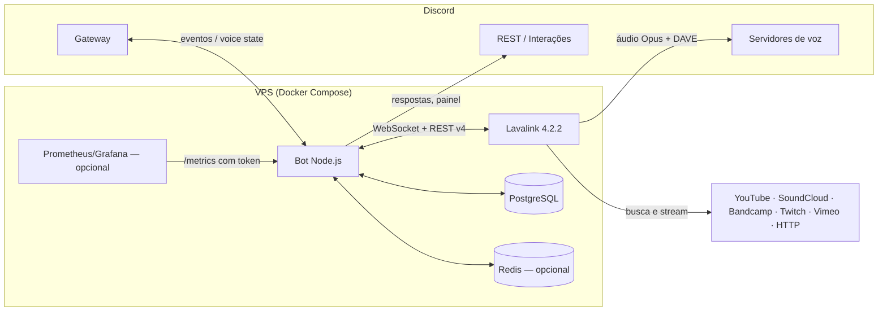
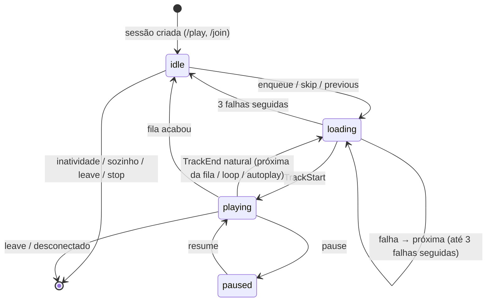
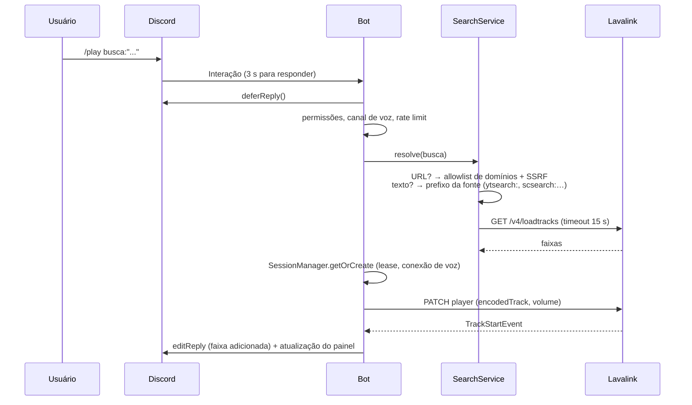

# Arquitetura

## Visão geral

O Aurora é um processo Node.js (o **bot**) que conversa com o Discord pelo gateway (discord.js) e
delega todo o processamento de áudio a um servidor **Lavalink**. O bot nunca baixa nem decodifica
áudio: ele decide _o que_ tocar (fila, permissões, regras) e o Lavalink busca o stream, codifica
em Opus, aplica filtros e envia a voz ao Discord (incluindo a criptografia DAVE).



### Redes do Compose

| Rede      | Tipo                            | Quem participa                          | Motivo                                                                              |
| --------- | ------------------------------- | --------------------------------------- | ----------------------------------------------------------------------------------- |
| `backend` | `internal: true` (sem internet) | bot, postgres, redis, lavalink, migrate | Comunicação interna; Postgres e Redis não alcançam nem são alcançados pela internet |
| `egress`  | normal                          | bot, lavalink                           | Bot fala com o Discord; Lavalink busca áudio e envia voz                            |

Nenhuma porta é publicada na interface pública. O bot publica `9464` (health/métricas) apenas em
`127.0.0.1`.

## Módulos do código

```
src/
├── index.ts               # entrada: carrega .env, valida config, sinais, encerramento gracioso
├── app.ts                 # composição: cria e liga todos os serviços
├── config/env.ts          # validação de variáveis de ambiente (Zod)
├── core/                  # logger, erros tipados, async (retry/backoff/timeout), rate limit, leases
├── music/                 # domínio: fila, sessão por servidor, gerenciador de sessões, autoplay
├── audio/                 # porta AudioEngine + implementação Lavalink, filtros
├── providers/             # catálogo de fontes, pesquisa, proteção SSRF
├── permissions/           # níveis e matriz de autorização (puro, sem Discord)
├── data/                  # Prisma: configurações, playlists, histórico, auditoria
├── ui/                    # tema, formatação, embeds, componentes, gerenciador do painel
├── discord/               # roteador de interações, comandos slash, adaptadores
└── observability/         # métricas Prometheus e servidor HTTP
```

As regras de negócio (`music/`, `permissions/`, `providers/`, `ui/`) não dependem de discord.js
nem do Lavalink diretamente: recebem interfaces (`AudioEngine`, `PanelTransport`,
`VoiceInspector`, `RateLimiter`). Isso permite testá-las com dublês e trocar o motor de áudio.

## Sessão de música

Cada servidor com o bot em um canal de voz tem um `GuildSession`. A fila própria (`MusicQueue`) é
a **fonte da verdade**; o Lavalink apenas toca a faixa que a sessão manda. O avanço automático da
biblioteca (`autoSkip`) fica desligado.



### Concorrência

- Toda mutação da sessão passa por `exclusive()`, uma cadeia de promessas por servidor. Cliques
  simultâneos em "pular", eventos do Lavalink e comandos são serializados.
- O botão "pular" carrega o `uid` da faixa exibida; se a faixa mudou entre o render e o clique,
  o clique é ignorado (evita pular duas músicas).
- `stop` muda o estado para `idle` _antes_ de parar o player, para que o `TrackEnd(stopped)`
  resultante não avance a fila.
- Faixa travada (`TrackStuck`): a sessão manda parar e espera o `TrackEnd(stopped)`; se ele não
  chegar em 4 s, avança mesmo assim.
- Leases (`LocalLeaseManager` ou `RedisLeaseManager` com `SET NX PX` + token de cerca) garantem que
  só uma instância controle a voz de um servidor. Com uma única instância o lease local basta.

### Sequência de `/play`



### Falhas e recuperação

| Situação                               | Comportamento                                                                                                                                                                                                                                 |
| -------------------------------------- | --------------------------------------------------------------------------------------------------------------------------------------------------------------------------------------------------------------------------------------------- |
| Faixa falha (`TrackException`)         | Aviso no canal, próxima faixa; 3 falhas seguidas param a reprodução                                                                                                                                                                           |
| Bot desconectado da voz                | Tentativas com backoff exponencial + jitter; desiste e encerra a sessão                                                                                                                                                                       |
| Códigos de fechamento de voz 4006/4009 | Sessão de voz inválida: reconecta e retoma a faixa na posição                                                                                                                                                                                 |
| Nó Lavalink cai                        | Sessões marcadas "reconectando"; painel mostra aviso; ao voltar, o player é recriado e a faixa retomada na última posição conhecida                                                                                                           |
| Postgres indisponível                  | Sessões em andamento continuam tocando; enquanto o cache de configurações (60 s) vale, novos comandos funcionam; depois, comandos que leem configurações, playlists e histórico retornam erro com código de correlação; `/readyz` reporta 503 |
| Redis indisponível                     | Rate limiter falha aberto (permite); sessões em andamento continuam; novas sessões são recusadas com mensagem amigável até o Redis voltar; `/readyz` reporta 503                                                                              |
| Mensagem do painel apagada             | Recriada na próxima atualização                                                                                                                                                                                                               |
| Reinício do bot                        | Sessões não são restauradas (decisão D-005); painéis antigos são marcados como encerrados                                                                                                                                                     |

## Painel

`PanelManager` mantém **uma** mensagem por servidor. Mudanças de estado agendam uma edição com
intervalo mínimo de 2,5 s (agrupando mudanças); enquanto toca, a barra de progresso é renovada a
cada `PANEL_UPDATE_INTERVAL_MS` (15 s). Os `customId` dos botões seguem
`<prefixo>:<ação>:<guildId>[:<arg>]` e são validados contra o servidor da interação.

## Interações

`discord/interactions.ts` roteia comandos, botões, menus e autocomplete. Para cada interação:

1. Rate limit por usuário (8 comandos/10 s; 6 cliques/5 s).
2. `deferReply` quando a operação pode passar de 3 s (pesquisas, banco).
3. Erros esperados (`UserError`) viram mensagens amigáveis; erros inesperados geram um código de
   correlação mostrado ao usuário e registrado no log.

## Observabilidade

- Logs JSON (pino) com `redact` de tokens/senhas e campos `guildId`, `command`, `correlationId`.
- `GET /healthz` (vivo), `GET /readyz` (Discord, banco, Lavalink, Redis), `GET /metrics`
  (Bearer token, prefixo `aurora_`). Métricas descritas em [OPERATIONS.md](OPERATIONS.md#métricas).

## Escala

Uma instância atende confortavelmente dezenas de servidores com reprodução simultânea; o gargalo
é o Lavalink (CPU para transcodificar/filtros e banda). Para crescer:

1. Aumentar recursos do Lavalink ou adicionar nós (`LAVALINK_NODES` aceita vários).
2. Sharding do discord.js (ShardingManager) com Redis obrigatório para leases e rate limit —
   não implementado nesta versão (ver [ROADMAP.md](ROADMAP.md)).
