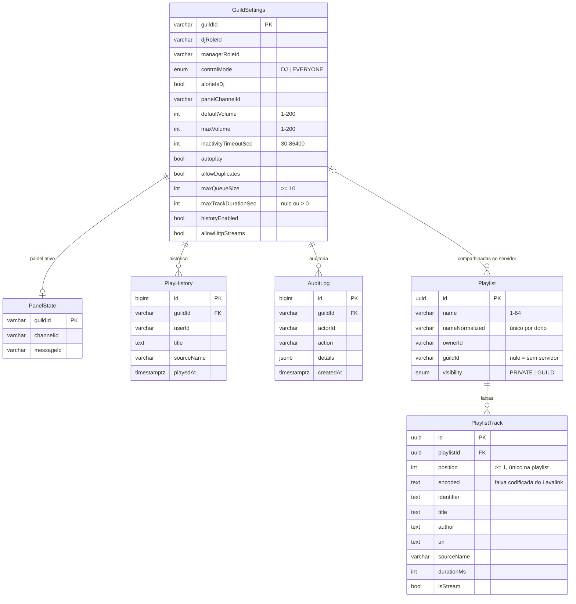

# Banco de dados

PostgreSQL 17 acessado pelo Prisma 7 (gerador `prisma-client`, driver `pg` via
`@prisma/adapter-pg`). Esquema: `prisma/schema.prisma`. Migrações: `prisma/migrations/`.

## O que é guardado (e o que não é)

| Guardado                                                           | Não guardado                           |
| ------------------------------------------------------------------ | -------------------------------------- |
| Configurações por servidor                                         | Fila e sessão atual (ficam em memória) |
| Playlists e suas faixas                                            | Conteúdo de mensagens                  |
| Histórico de reprodução (opcional por servidor, retenção 90 dias)  | Áudio                                  |
| Log de auditoria de alterações administrativas (retenção 180 dias) | Tokens/credenciais de usuários         |
| Mensagem do painel ativo (para fechá-la após reinício)             | Endereço IP, e-mail                    |

IDs do Discord (snowflakes) são guardados como `VARCHAR(20)`.

## Modelo

### Decisões do modelo

- **Faixa codificada + metadados:** `encoded` permite tocar a faixa sem nova pesquisa; os
  metadados permitem listar a playlist sem consultar o Lavalink. Se um `encoded` deixar de ser
  aceito após uma atualização do Lavalink, a faixa falha ao tocar e a fila segue; refazer a
  pesquisa pelo `uri` automaticamente está no [ROADMAP.md](ROADMAP.md).
- **Posições densas (1..n) com `UNIQUE(playlistId, position)`:** adicionar faixa trava a playlist
  com `SELECT … FOR UPDATE`; remover desloca as posições em duas etapas (+1.000.000 e depois
  −1.000.001) para não violar a unicidade nem o `CHECK position >= 1` no meio da transação.
- **Nome normalizado** (minúsculas, espaços colapsados, NFKC) garante unicidade por dono sem
  diferenciar "Rock" de "rock".
- **Restrições `CHECK`** (migração `20261027171500_check_constraints`) protegem o banco mesmo que
  um bug na aplicação tente gravar valores inválidos.
- **Remoção do bot de um servidor:** a sessão é encerrada, mas os dados **não** são apagados
  automaticamente (uma remoção acidental não deve destruir configurações e playlists). Histórico
  e auditoria expiram pela retenção. Para apagar tudo de um servidor manualmente, veja
  [OPERATIONS.md](OPERATIONS.md#apagar-dados-de-um-servidor): as configurações caem em cascata
  para painel, histórico e auditoria, e playlists compartilhadas nele viram privadas do dono
  (`ON DELETE SET NULL`).

## Migrações

| Comando                             | Quando                                                                           |
| ----------------------------------- | -------------------------------------------------------------------------------- |
| `pnpm db:migrate:dev --name <nome>` | Desenvolvimento: cria uma migração a partir do schema                            |
| `pnpm db:migrate:deploy`            | Aplica migrações pendentes (o serviço `migrate` do Compose faz isso a cada `up`) |
| `pnpm prisma migrate status`        | Lista o que falta aplicar                                                        |

Regras:

1. Nunca edite uma migração já aplicada em produção; crie outra.
2. Migrações destrutivas (remover coluna/tabela, mudar tipo com perda) exigem: backup antes
   (`scripts/backup.sh`), revisão manual do SQL gerado e, de preferência, duas etapas (parar de usar
   → remover numa versão seguinte).
3. O teste `tests/integration/migrations.test.ts` verifica que as migrações aplicadas do zero
   produzem exatamente o schema (`prisma migrate diff` sem diferenças).

## Retenção

Uma tarefa diária no próprio bot apaga histórico mais antigo que `HISTORY_RETENTION_DAYS` (90) e
auditoria mais antiga que `AUDIT_RETENTION_DAYS` (180). `/privacy delete` apaga imediatamente
playlists, preferências e histórico do usuário.

## Conexões

Pool do `pg` com `DATABASE_POOL_MAX` (10) conexões, timeout de conexão de 5 s, conexões ociosas
fechadas após 30 s e `statement_timeout` de 15 s por consulta.

## Seed

`pnpm db:seed` (somente fora de produção) cria as configurações padrão do servidor de
`DISCORD_DEV_GUILD_ID`. É idempotente e não altera dados existentes.
